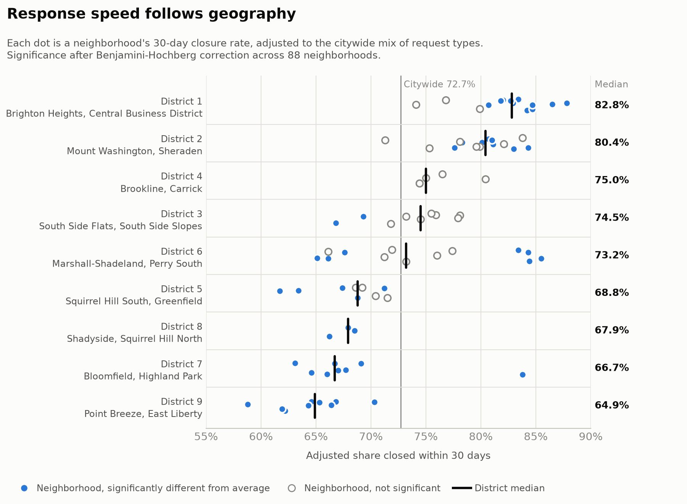
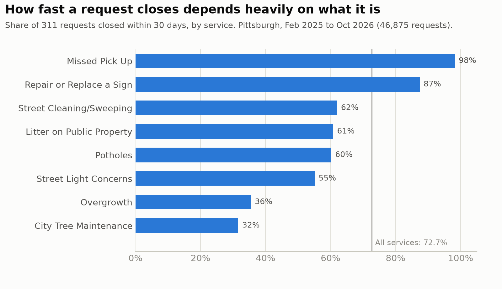

# Do some Pittsburgh neighborhoods wait longer for city services?

An analysis of 46,875 City of Pittsburgh 311 service requests (February 2025 to October 2026). After accounting for the type of request, neighborhoods differ substantially in how quickly the city closes requests, and the differences follow geography. In the typical neighborhood of Council District 1 (North Side and Downtown), 83% of requests close within 30 days; in District 9 (East End), 65% do.

**Tools:** SQL (SQLite) for exploration and cleaning; Python (pandas, statsmodels, matplotlib) for logistic regression, multiple-comparison correction and charts.



## Key findings

- **The type of request matters most.** 98% of missed trash pickups close within 30 days, but only 32% of tree maintenance requests. Comparing neighborhoods' raw closure rates mostly compares what their residents report.
- **After adjusting for request type, neighborhoods still differ.** 56 of 88 neighborhoods differ significantly from the average neighborhood after Benjamini-Hochberg correction: 31 slower and 25 faster.
- **The differences follow geography.** District medians range from 82.8% (District 1) and 80.4% (District 2) down to 64.9% (District 9), with Districts 5, 7, 8 and 9 (East End and Southeast) all at the bottom.
- **The result holds with a stricter definition.** With a 14-day window instead of 30, neighborhoods rank almost the same way (rank correlation 0.91) and the same districts lead and trail.

## Question

Do some Pittsburgh neighborhoods wait significantly longer for city services, after controlling for the type of request?

## Data

[Pittsburgh 311 Data](https://data.wprdc.org/dataset/pittsburgh-311-data), published by the Western Pennsylvania Regional Data Center (WPRDC), downloaded November 5, 2026: 981,193 requests, each with a created timestamp, a closed timestamp once closed, request type, department and neighborhood.

The city moved to a new 311 system on February 4, 2025. Only requests created on or after that date are used. 82% of the rows predate it, and they behave differently:

- Two-thirds of all open requests (65,181 of 98,142) are from the old system, many of them years old. They look like tickets that were never closed, not work in progress.
- The old system flagged only 5 duplicates in ten years, so its data contains duplicates that can't be detected.
- 99.96% of old-system timestamps end in :00 seconds (minute precision), against 1.6% in the new system, so response times aren't measured the same way.

## Method

### Cleaning (SQL)

| Step | Requests remaining |
|---|---:|
| All requests | 981,193 |
| Created in the new system (on or after Feb 4, 2025) | 175,980 |
| At least 30 days old at download (created before Oct 6, 2026) | 169,142 |
| Assigned to a department | 164,167 |
| One of 8 physical services done by city crews | 49,440 |
| Duplicates removed | 47,924 |
| Requests with no neighborhood removed | 47,458 |
| Census "Block Group" labels removed (not real neighborhoods) | 46,938 |
| Neighborhoods with at least 50 requests | **46,875** |

Canceled requests and requests marked closed without a closed date were also checked; none remained by that point.

Key decisions, each documented with its evidence in [`sql/02_clean.sql`](sql/02_clean.sql):

- **Which services count.** Many 311 request types aren't jobs that end in a fix: traffic-calming suggestions, crash reports and bicycle-safety concerns were 99-100% still open after 90 days. The analysis keeps 8 physical services performed by city crews: missed pickups, potholes, street lights, litter, signs, street cleaning, city trees and overgrowth. Services were chosen by who does the work (the assigned department), not by how fast they close, which would be circular. Similar-sounding types were split this way: Overgrowth goes to street-maintenance crews (kept), while Weeds or Debris goes to building inspectors who cite private owners (excluded). Snow and ice requests were excluded: most were filed in winter 2025-26 (61% in January 2026 alone), and only 1 of about 18,000 is still open, consistent with being closed in bulk rather than street by street.
- **Requests that never close.** Of requests created between February and November 2025, 11-18% (depending on the month) were still open in November 2026. Measuring time-to-close for closed requests only would hide the slowest cases. Instead the outcome is **closed within 30 days (yes/no)**: a request still open counts as "no". Only requests at least 30 days old are included, so every request has a definite answer.
- **Response time** is computed from UTC timestamps, so daylight-saving changes don't add hour-long errors.

### Why the raw numbers mislead



Closure rates differ by 67 percentage points between services, and missed pickups are 39% of all requests. A neighborhood that mostly reports missed pickups looks fast and one that reports many tree problems looks slow, regardless of how the city treats them. The model compares neighborhoods within each request type.

### Model (Python)

- **Logistic regression** of closed-within-30-days on neighborhood and request type ([`notebooks/03_analysis.ipynb`](notebooks/03_analysis.ipynb)).
- Neighborhoods are compared with the **average neighborhood** (sum coding), not with one chosen reference neighborhood.
- Each neighborhood's **adjusted closure rate** is the share of all 46,875 requests the model predicts would close within 30 days if they had been filed in that neighborhood. Every neighborhood gets the same request mix, so the rates are directly comparable.
- With 88 neighborhoods tested, about 4 would look significant by chance at the usual 5% level, so p-values are adjusted with the **Benjamini-Hochberg** method.
- Results per neighborhood: [`results/neighborhood_results.csv`](results/neighborhood_results.csv).

## Results

Adjusted 30-day closure rates range from 58.8% to 87.8% across neighborhoods. The single highest and lowest values come from small neighborhoods with wide confidence intervals, so the district medians are a more reliable summary.

| Council district | Example neighborhoods | Median adjusted rate, 30 days | 14 days |
|---|---|---:|---:|
| 1 | Brighton Heights, Central Business District | 82.8% | 72.8% |
| 2 | Mount Washington, Sheraden | 80.4% | 68.7% |
| 4 | Brookline, Carrick | 75.0% | 66.1% |
| 3 | South Side Flats, South Side Slopes | 74.5% | 66.0% |
| 6 | Marshall-Shadeland, Perry South | 73.2% | 55.5% |
| 5 | Squirrel Hill South, Greenfield | 68.8% | 58.8% |
| 8 | Shadyside, Squirrel Hill North | 67.9% | 56.1% |
| 7 | Bloomfield, Highland Park | 66.7% | 54.0% |
| 9 | Point Breeze, East Liberty | 64.9% | 54.5% |

**The pattern is not simply about income.** Income was not tested directly, but the ranking cuts across it: Northview Heights, a public-housing community, has the highest adjusted rate, while Point Breeze, one of the city's wealthier neighborhoods, is among the slowest.

**District 6 is split.** Four of its neighborhoods (Marshall-Shadeland, Manchester, Perry South, California-Kirkbride) are among the fastest in the city under both windows; the other nine (for example Upper Hill, Bluff and West Oakland) are slower and fall further behind with a 14-day window. Its median moves from the middle to near the bottom for that reason. Council districts are a convenient summary, not a natural unit.

## Robustness

- **14-day window.** Refitting with closed-within-14-days gives a neighborhood rank correlation of 0.91 with the 30-day results, and the same districts lead (1, 2) and trail (7, 9). The roughly 18-point gap between Districts 1 and 9 is the same under both windows.
- **Requests with no assigned department** were excluded. Within the final scope there are only 461 of them, closing within 30 days at 71.8%, close to the overall 72.7%, so they can't drive the result.

## Limitations

- **Closed is not the same as fixed.** Departments close requests themselves, so the data measures when a request was marked closed.
- **Some duplicates are unflagged.** Only duplicates the city marked are removed.
- **This shows where, not why.** The geographic pattern could reflect crew and division workloads, travel distances, terrain or how residents report problems. This data can't separate these explanations.
- **Who reports differs by neighborhood.** 311 data covers only problems someone reported.
- **Scope.** 8 services over 21 months. Two neighborhoods with fewer than 50 requests (Arlington Heights, St. Clair) are excluded.
- **Main district.** Neighborhoods that straddle a district boundary are assigned the district where most of their requests were filed.

## Next steps

- Join Census income and demographic data by census tract to test the income question directly.
- Add Department of Public Works division boundaries or crew data to test whether workload explains the geographic pattern.
- Model time-to-close directly with survival analysis, which uses open requests without a fixed window.

## Reproduce

```bash
python3 -m venv .venv && source .venv/bin/activate
pip install -r requirements.txt
# Download the 311 Data CSV from WPRDC into data/, then:
python scripts/build_database.py data/<downloaded file>.csv
# Open notebooks/03_analysis.ipynb and run all cells
```

The raw data isn't in this repository (about 315 MB). WPRDC updates it several times a day, so a newer download will give slightly different numbers. The date cutoffs in `sql/02_clean.sql` assume a November 5, 2026 download.

## Repository layout

```
sql/01_explore.sql          first look at the raw data
sql/02_clean.sql            cleaning decisions with evidence; builds the analysis views
sql/03_results.sql          council districts and the 14-day robustness view
scripts/build_database.py   rebuilds data/pgh311.db from the raw CSV
notebooks/03_analysis.ipynb models, adjusted rates, robustness check, charts
results/                    per-neighborhood results
figures/                    charts used in this README
```
